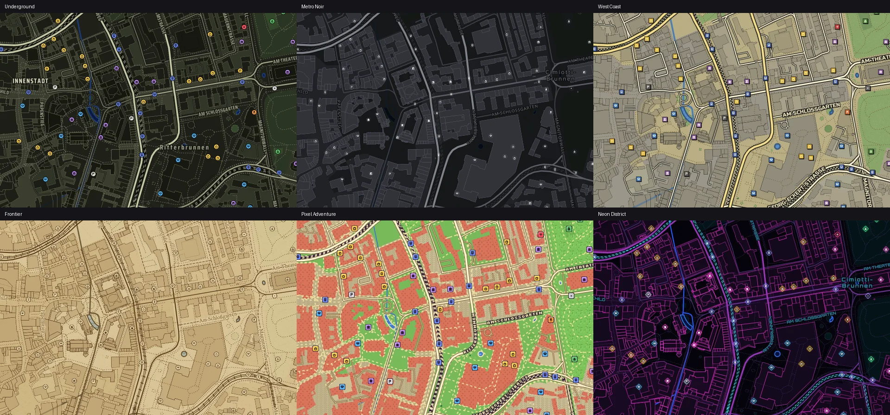
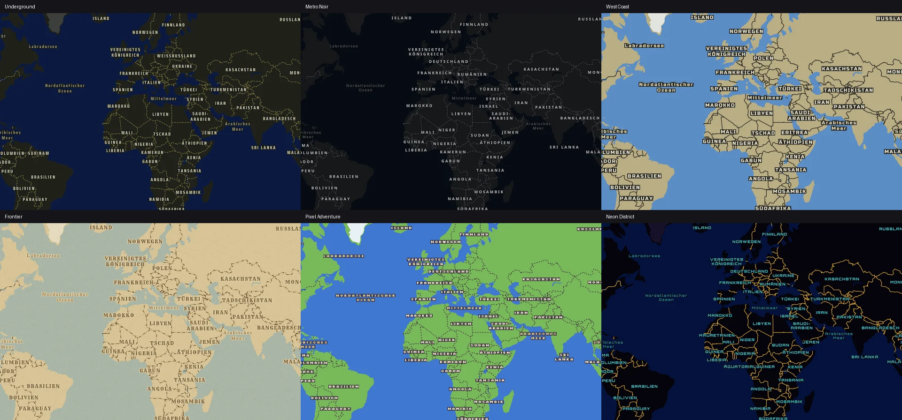

# Kartenstyles – Vergleich

Echt gerenderte Karten (MapLibre, OpenFreeMap-Kacheln), identischer Ausschnitt und Zoom.

- 
- 

Neu erzeugen: `npm run dev -w @nam/web -- --port 5199`, dann `node scripts/render-style-previews.mjs <ordner> all`. Das Labor (`apps/web/style-lab.html`) ist reines Entwicklungswerkzeug und nicht Teil des Builds.
© OpenStreetMap-Mitwirkende · © OpenMapTiles
